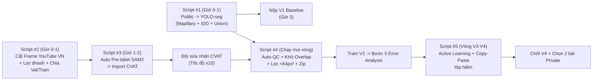

# Bản Thiết Kế Tác Chiến Toàn Diện (Làm 100% Tại Phòng · Mục Tiêu Top 1)
**Cuộc thi:** AIInAction RoboTaxi Data Centric Competition (Khóa 5)  
**Đội:** Đội 18 (`TEAM_ID = 23`) · **Model cố định:** `YOLO26n-seg` (`imgsz=640`, 11 lớp)  
**Mục tiêu:** Giải cao nhất (**50% Private LB** + **50% Thuyết trình Giải pháp**)

---

## 1. Kho Public Datasets Tuyển Chọn (Đã Tìm Sẵn · Link Trực Tiếp · Lấy Ngay Tại Phòng)

Thay vì mất hàng giờ đi tìm hay tải các bộ 30–50GB gây nghẽn Colab, Đội 18 chỉ cần tập trung vào **2 nhóm nguồn vàng**: **(A) Public có sẵn Polygon Instance để dựng khung 11 lớp siêu nhanh** và **(B) Kho ảnh Đường Phố Việt Nam thật lấy 100% online ngay tại phòng**.

### Nhóm A: Public Datasets có sẵn Polygon Instance (Xương sống 11 lớp)

| # | Bộ dữ liệu & Link trực tiếp | Nền tảng / Cách lấy nhanh | Giấy phép (Ghi vào Slide) | Giá trị chiến lược cho 11 lớp | Lưu ý bắt buộc khi xử lý |
|---:|---|---|---|---|---|
| **1** | **Mapillary Vistas v2** • HuggingFace: [`candylion/mapillary-vistas-v2`](https://huggingface.co/datasets/candylion/mapillary-vistas-v2) • Cổng gốc: [mapillary.com/dataset/vistas](https://www.mapillary.com/dataset/vistas) | **HF `datasets` (Streaming!)** — chỉ tải đúng số ảnh đã lọc, không phải kéo cả 25.000 ảnh! | Mapillary Vistas Research License *(non-commercial / academic — rất hợp lệ cho hackathon VinUni)* | **SỐ 1 VỀ ĐỘ PHỦ 11 LỚP:** Có sẵn mask cực sắc cho `car`, `bus`, `truck`, `trailer` + `wheeled-slow` (`Other vehicle`), `motorcycle`, `bicycle`, `motorcyclist`, `bicyclist`, `person`, **`traffic-sign--front` & `traffic-sign--back` (có cả lưng biển!)**, `traffic-light`. | Chạy **Rider-Bike Polygon Union** để gộp `motorcyclist + motorcycle` → ID `5` và `bicyclist + bicycle` → ID `7`. Chỉ trích **1.000 – 1.200 ảnh tinh lọc** (giàu lớp hiếm, góc nhìn ngang tầm xe). |
| **2** | **Indian Driving Dataset (IDD)** • Kaggle gốc (10k ảnh + JSON polygon): [`manjotpahwa/indian-driving-dataset`](https://www.kaggle.com/datasets/manjotpahwa/indian-driving-dataset) • Kaggle Part 2 (RGB + JSON + mask): [`sovitranjan/indian-driving-dataset-segmentation-part-2`](https://www.kaggle.com/datasets/sovitranjan/indian-driving-dataset-segmentation-part-2) • Kaggle bản YOLO-seg sẵn: [`muhammadibrahim01/indian-driving-dataset-segmentations-yolov11-seg`](https://www.kaggle.com/datasets/muhammadibrahim01/indian-driving-dataset-segmentations-yolov11-seg) • Cổng gốc: [IDD – IIIT Hyderabad](http://insaan.iiit.ac.in/) | **Kaggle Input Mount (0 giây tải!)** hoặc `kagglehub` trên Colab. | Academic / Non-Commercial Research (IIIT Hyderabad) | **SỐ 1 VỀ BỐI CẢNH ĐÔNG NAM Á / VIỆT NAM:** Giao thông hỗn hợp giống VN tới 80% — mật độ xe máy cực dày, chở 2–3 người, **`autorickshaw` (ba gác/xe lam → `Other vehicle`)**, `caravan`/`trailer`, `rider`, `bus`, `truck`, bụi bặm, che khuất nặng. | Chạy **Rider-Bike Union** cho `rider + motorcycle/bicycle`. Kiểm tra xem subset dùng có đủ nhãn `Sign` & `Traffic light` không; nếu thiếu 2 lớp này phải chạy **Auto-Fill bằng Teacher + SAM2** trước khi trộn (tránh *Missing-Class Poisoning*). |
| **3** | **Cityscapes / BDD100K (Dự phòng Đêm/Mưa)** • HF Cityscapes: [`tanganke/cityscapes`](https://huggingface.co/datasets/tanganke/cityscapes) hoặc [`Chris1/cityscapes`](https://huggingface.co/datasets/Chris1/cityscapes) • Kaggle BDD100K: [`solarthief/bdd100k-images`](https://www.kaggle.com/datasets/solarthief/bdd100k-images) | HF `datasets` / Kaggle Input | Cityscapes / BSD-3-Clause (BDD100K) | Chỉ dùng **200 ảnh đêm/mưa/hoàng hôn** từ BDD100K nếu kho YouTube VN thiếu cảnh mưa/đêm. | **Cảnh báo:** BDD100K ins-seg thiếu `Sign` & `Traffic light` → chỉ dùng khi đã chạy Script #3 bù nhãn 2 lớp này! |

### Nhóm B: Nguồn Ảnh Đường Phố Việt Nam Thật 100% (Lấy Ngay Trong Phòng · Không Cần Ra Đường!)

Đây chính là bí quyết giúp đội bạn **vẫn có 700 – 1.000 ảnh Việt Nam cực "xịn"** mà không phải bước chân ra khỏi phòng:

| # | Nguồn ảnh Việt Nam online | Link / Cách lấy ngay | Tại sao cực kỳ đắt giá? | Cách chuyển thành nhãn Instance Seg siêu tốc |
|---:|---|---|---|---|
| **1** | **YouTube 4K Dashcam Đường Phố Việt Nam** | Dùng `yt-dlp` tải 8–12 video lái xe 4K góc camera hành trình (từ khóa: `"driving in Hanoi 4K dashcam"`, `"driving in Ho Chi Minh City 4K"`, `"lái xe Hà Nội trời mưa đêm 4K"`, `"quốc lộ 1A container camera hành trình"`). | **100% đúng góc camera RoboTaxi**, đủ mọi bối cảnh test ẩn: ban ngày đông xe máy, ngã tư đèn giao thông đếm ngược VN, xe buýt VN, đầu kéo + container, ba gác/xích lô, hoàng hôn, mưa, đêm tối! | Cắt 1 frame mỗi 4–5 giây + lọc `dhash > 8` → chạy **Script #3 (Pre-label SAM2)** → sửa nhanh trên CVAT. *(Tách hẳn 3–4 video riêng không chạm tới làm tập **Golden VN Val**!)* |
| **2** | **HF Vietnam Traffic Sign (Ảnh đường phố VN thật)** [`star092304/Traffic-sign-detection-VietNam`](https://huggingface.co/datasets/star092304/Traffic-sign-detection-VietNam) | Tải trực tiếp bằng `datasets` trên Colab/Kaggle (>10.000 ảnh đường phố VN + sẵn bbox biển báo!). | **Vừa có ảnh đường phố VN thật, vừa có sẵn vị trí (bbox) biển báo VN cực chuẩn** (thứ mà model nước ngoài hay sót nhất!). | **Mẹo ăn điểm:** Dùng chính **GT bbox biển báo có sẵn** làm box-prompt đẩy thẳng vào **SAM2** để đẻ ra polygon mặt biển báo chuẩn 99%, đồng thời chạy Teacher+SAM2 cho 10 lớp còn lại → đưa lên CVAT QC siêu nhanh! |
| **3** | **Zalo AI Traffic Sign Dataset (Street View VN)** [`datasetninja.com/zalo-traffic-sign`](https://datasetninja.com/zalo-traffic-sign) | Tải ảnh street-view đường phố thành thị & nông thôn VN (1622×626). | Cực giàu cảnh **biển báo VN ở khoảng cách trung bình – xa** và phố VN có nhiều biển quảng cáo cửa hàng (rất tốt để tạo **Hard Negatives** & luyện lớp `Sign`). | Tương tự trên: box biển báo → SAM2 mask + Teacher cho xe cộ + QC tay. |

> [!CAUTION]
> **Nhớ quy tắc bản quyền & minh bạch cho 50% điểm Thuyết trình:** Mọi nguồn Public Dataset (Mapillary Vistas v2, IDD, `star092304/Traffic-sign-detection-VietNam`, Zalo Traffic Sign) và danh sách link video YouTube Creative Commons / công khai dùng để trích ảnh đều phải **lưu thành 1 bảng Excel/Markdown ngay từ lúc tải** (Tên, URL, License, Số ảnh trích, Cách map lớp) để dán thẳng vào Slide báo cáo!

---

## 2. Đề Xuất "Best Choice" Về GPU & Kiến Trúc Hạ Tầng (Khi Máy Nhóm Yếu)

Đừng chỉ phụ thuộc vào **1 tài khoản Google Colab Free** (rất dễ bị cắt giữa chừng sau 3–4 tiếng hoặc dính giới hạn GPU đúng lúc nước rút nửa đêm!).

### Phương án TỐI ƯU NHẤT (Best Choice): **Combo "Kaggle Free (Trụ cột) + Google Colab (Phụ trợ)"**

| Tiêu chí | Google Colab Free (T4) | **Kaggle Notebooks Free (KHUYÊN DÙNG SỐ 1)** | Google Colab Pro (~250k/nhóm) |
|---|---|---|---|
| **GPU & VRAM** | 1× T4 (16 GB) | **2× T4 (32 GB)** hoặc **1× P100 (16 GB)** | **1× L4 (24 GB)** *(ngon-bổ-rẻ nhất)* |
| **Hạn mức chạy** | Không cố định, hay bị ngắt sớm sau 2–4h | **30 giờ GPU MIỄN PHÍ / tuần / mỗi tài khoản!** Chạy nền liên tục **tối đa 12 giờ/phiên** không bị đá khi tắt trình duyệt! | 100 compute units (~50 giờ chạy L4!) |
| **Tốc độ nạp dataset** | Chậm (mount Drive + giải nén mỗi lần reset) | **Tức thì (0 giây!)** khi gắn dataset qua Kaggle Datasets (`IDD`, `team18-dataset-vX`) | Nhanh nếu lưu trên Drive + copy sang `/content` |
| **Thời gian train `YOLO26n-seg` (2.500 ảnh × 80 epochs, `imgsz=640`)** | ~45–60 phút | **~30–40 phút** (P100 hoặc T4×2 DDP) | **~15–22 phút** (L4) |
| **Khả năng chạy song song** | Dễ bị khóa nếu mở nhiều tab | **4 thành viên = 4 tài khoản Kaggle = 120 giờ GPU miễn phí chạy song song 4 thí nghiệm cùng lúc!** | Chạy cực mượt 1 máy chính |

### Cấu hình phân bổ GPU "chuẩn không cần chỉnh" cho Đội 18:
1. **Nếu ngân sách 0 đồng (100% Free — Đủ sức vô địch):**
   - **Kaggle Account #1 (GPU T4×2 hoặc P100):** Chuyên chạy **Script #3 (Auto Pre-label YOLO11x/Grounded-SAM2)** trên hàng nghìn ảnh VN để đẩy lên CVAT liên tục.
   - **Kaggle Account #2 & #3 (GPU P100 / T4×2):** Chuyên chạy [train_and_export.ipynb](file:///C:/Users/Admin/Downloads/train_and_export.ipynb) (bật **Internet = ON**, **Accelerator = GPU P100 hoặc T4×2**). Mỗi vòng dataset mới (V1, V2, V3, V4), upload 1 file zip lên **Private Kaggle Dataset** của đội (ví dụ `team18-robotaxi-v2`) → mọi thành viên gắn vào notebook trong 1 giây, chạy **Save & Run All (Commit)** nền để không bao giờ rớt mạng!
   - **Google Colab Free (CPU/T4):** Dùng làm trạm trung chuyển chạy Script #1, #2, #4 (cắt frame, lọc `dhash`, gộp polygon, Auto-QC) và lưu trữ đồng bộ toàn bộ `best.pt`, `submission.zip`, `run_report.json` lên **1 thư mục Google Drive chung của Đội 18**.
2. **Nếu cả nhóm sẵn sàng góp ~250k VNĐ mua 1 tài khoản Colab Pro:**
   - Chọn **GPU L4 (24 GB)** (tuyệt đối đừng đốt units vào A100 vì `YOLO26n-seg` rất nhẹ, L4 là dư tốc độ mà tiết kiệm gấp 4 lần units). Kết hợp thêm Kaggle Free để chạy song song Pre-label SAM2!

---

## 3. Định Mức Số Lượng Ảnh Thực Tế (Tối Ưu Cho `YOLO26n-seg` Trong 24h)

Vì `YOLO26n-seg` chỉ là mô hình nano (~2.68M tham số Conv), **độ sạch + độ sát viền mask + độ cân bằng 11 lớp** ăn đứt số lượng khổng lồ. Dưới đây là **công thức tỉ lệ vàng** đã tính toán khớp với sức làm việc của 1 nhóm trong 24 giờ:

### Bảng Định Mức Số Lượng Ảnh (Target Dataset Recipe)

| Phần dữ liệu | Số lượng đề xuất | Nguồn lấy (100% tại phòng) | Tỉ lệ & Yêu cầu chất lượng |
|---|---:|---|---|
| **1. Tập Golden VN Val (Cố định)** | **200 ảnh** | Cắt từ **3–4 video YouTube 4K Dashcam VN tách biệt hoàn toàn** + ~30 ảnh VN từ HF/Zalo (không trùng cảnh với Train). | **100% ảnh VN thật**, đủ 11 lớp (**≥ 25 instances/lớp**), **QC 2 người 100%**. Đóng sẵn vào `images/val`. |
| **2. Tập Train — Ảnh VN thật (Core + Hard Cases)** | **700 – 1.000 ảnh** *(Mốc V1: 150 → V2: 500 → V3/V4: 800–1.000)* | • ~60% từ 8–10 video YouTube 4K Dashcam VN (ngày, đêm, mưa, hoàng hôn, ngã tư, quốc lộ) • ~30% từ `star092304/Traffic-sign-detection-VietNam` & Zalo (giàu biển báo + phố VN) • ~10% (**60–100 ảnh**) **Hard Negatives** (biển quảng cáo, đèn LED, showroom, áp phích — `.txt` rỗng hoặc ít vật thể). | **Pre-label SAM2 + 100% Human Review trên CVAT + Auto-QC**. Tính khả thi: 1 người sửa pre-label được **40–50 ảnh/giờ** → 4 người × 5 tiếng = **800–1.000 ảnh siêu sạch!** |
| **3. Tập Train — Public chuẩn hóa** | **1.500 – 1.800 ảnh** | • **Mapillary Vistas v2:** 1.000 – 1.200 ảnh tinh lọc (giàu `Other vehicle`, `Bicycle`, `Cyclist`, `Sign back/front`, `Traffic light`, `Bus`) • **IDD (Kaggle):** 500 – 600 ảnh tinh lọc (giàu `autorickshaw`/ba gác, xe máy đông đúc, `trailer`, `truck`). | Chạy **Rider-Bike Union** + **Auto-Fill lớp thiếu** + lọc `< 64 px²` + khử overlap. |
| **4. Bơm lớp hiếm (Targeted Copy-Paste)** | **+200 – 300 ảnh tổng hợp** *(chỉ ở vòng V3/V4)* | Cắt các instance SAM cực nét của lớp yếu (`Other vehicle`, `Cyclist`, `Bicycle`, `Traffic light`, `Sign`) dán đúng tỉ lệ phối cảnh lên ảnh nền đường VN. | Đảm bảo **MỌI lớp trong 11 lớp đều đạt ≥ 300 instances** trong Train và `imbalance_ratio ≤ 15x`. |
| **TỔNG CỘNG (FINAL V4)** | **~2.500 – 3.000 ảnh Train + 200 ảnh Golden Val** | **Tỉ lệ ~55% Public chuẩn hóa : ~45% Đường phố VN thật** | Train 80 epochs chỉ mất **30–40 phút** trên Kaggle P100/T4×2 — vừa cực sắc cho `YOLO26n-seg`, vừa đủ thời gian lặp 4 vòng! |

---

## 4. Thứ Tự Triển Khai 5 Script Python (Ưu Tiên Đúng Cái Cần Trước!)

Đừng viết dàn trải! Hãy triển khai đúng theo thứ tự **1 → 2 → 3 → 4 → 5** dưới đây để **chỉ sau 3 giờ đội bạn đã có điểm Public LB đầu tiên**, rồi tăng tốc dần mà không bao giờ bị tắc cổ chai:

### Chi tiết 5 Script theo đúng thứ tự ưu tiên:

1. **🥇 Script #1 — `01_vn_frame_harvester.py` (TRIỂN KHAI ĐẦU TIÊN — Mất 20 phút viết & chạy):**
   - **Lý do làm số 1:** Trong lúc kỹ sư khác xử lý Public Dataset, **đội gán nhãn CVAT cần có ảnh Việt Nam ngay lập tức để không bị ngồi chờ!**
   - **Chức năng:**
     - Nhận danh sách link YouTube 4K Dashcam VN (chia sẵn 2 danh sách: `VAL_URLS` và `TRAIN_URLS` để cách ly scene 100%) + trích ảnh từ `star092304/Traffic-sign-detection-VietNam`.
     - Cắt frame cách nhau 4–5 giây, tự động loại ảnh mờ (Laplacian variance thấp) và loại ảnh gần giống nhau (`dhash` Hamming distance `≤ 8`).
     - Xuất ra 2 thư mục sạch: `vn_val_raw/` (~250 ảnh) và `vn_train_pool/` (~3.000 ảnh để lấy dần cho V1, V2 và Active Learning V3).

2. **🥈 Script #2 — `02_auto_prelabel_sam2.py` (TRIỂN KHAI THỨ 2 — Đòn bẩy tốc độ x10 cho cả đội):**
   - **Lý do làm số 2:** Có ảnh VN từ Script #1 xong là bơm ngay qua Script #2 trên GPU Kaggle/Colab để ra nhãn polygon nháp siêu mịn, import thẳng vào CVAT. Nhờ vậy sau **60 phút kể từ bây giờ**, toàn bộ thành viên gán nhãn đã bắt đầu sửa tập **Golden VN Val (200 ảnh)** và lô VN Train đầu tiên!
   - **Chức năng:**
     - Chạy Teacher mạnh (`YOLO11x-seg` / `YOLO26x-seg` + `SAM2` tinh chỉnh viền, và/hoặc `GroundingDINO + SAM2` cho các lớp đặc thù `ba gác`, `rơ-moóc`, `biển báo`, `đèn giao thông`).
     - Tự động thực thi thuật toán **Rider-Vehicle Union**: ghép `person` ngồi trên `motorcycle`/`bicycle` thành 1 polygon duy nhất `Motorcyclist` (5) / `Cyclist` (7).
     - Xuất trực tiếp gói `YOLO Segmentation 1.0` sẵn sàng nạp vào CVAT!

3. **🥉 Script #3 — `03_public_mapillary_idd_converter.py` (TRIỂN KHAI SONG SONG VỚI #1 & #2):**
   - **Lý do làm số 3:** Đảm bảo đội có ngay **1.500 ảnh Public chuẩn 11 lớp** để ghép cùng 150–200 ảnh VN đầu tiên train **V1 Baseline** và nộp lượt #1 trước 15:30 chiều nay.
   - **Chức năng:**
     - Đọc streaming **Mapillary Vistas v2** (từ HuggingFace) và **IDD** (từ Kaggle Input).
     - Tự động lọc lấy các ảnh **giàu lớp hiếm** (`Other vehicle`, `Bicycle`, `Cyclist`, `Bus`, `Traffic light`, `Sign`).
     - Áp dụng **Rider-Vehicle Union** + ánh xạ chính xác sang 11 ID (`0..10`) + tự sinh file log `public_provenance.csv` (số ảnh, số instance từng lớp mỗi nguồn — dùng thẳng cho Slide!).

4. **🛡️ Script #4 — `04_auto_qc_and_packager.py` (LÁ CHẮN BẮT BUỘC CHẠY TRƯỚC MỌI LẦN TRAIN):**
   - **Lý do làm số 4:** Ngăn 100% lỗi kỹ thuật làm tụt điểm oan (`mAP@[.5:.95]` cực nhạy với lỗi polygon và chồng lấn mask!).
   - **Chức năng:**
     - Hợp nhất Public sạch + VN đã sửa trên CVAT + Hard Negatives + Golden Val cố định.
     - Tự động sửa polygon tự cắt (`shapely.make_valid`), lọc bỏ mọi mask `< 64 px²` ở scale 640 (`MIN_GT_AREA_PX = 64`), kiểm tra ID `0..10` và tọa độ `[0, 1]`.
     - **Khử chồng lấn mask (Non-Overlap Enforcement):** Sắp xếp instance theo thứ tự độ sâu (vật ở phía trước có đáy bbox `y_max` lớn hơn giữ pixel), tự động trừ phần giao khỏi mask vật phía sau — đáp ứng 100% nguyên tắc số 2 trong [labeling_guideline.md](file:///C:/Users/Admin/Downloads/labeling_guideline.md)!
     - Quét `dhash` chéo giữa `train/` và `val/` (xóa ngay mọi ảnh train gần giống val để **0% leakage**).
     - Xuất báo cáo thống kê 11 lớp + đóng gói `dataset_vX.zip` đúng chuẩn Ultralytics nạp thẳng vào Bước 1 của [train_and_export.ipynb](file:///C:/Users/Admin/Downloads/train_and_export.ipynb).

5. **🚀 Script #5 — `05_active_learning_and_copypaste.py` (VŨ KHÍ BỨT TỐC VÒNG V3 → V4):**
   - **Lý do làm số 5:** Chỉ dùng khi đã có `best.pt` của V2 và bảng AP từng lớp ở Bước 5.
   - **Chức năng:**
     - **Active Learning Miner:** Chạy `best.pt` V2 trên kho `vn_train_pool/` (2.000+ frame VN chưa gán) → tính điểm bất định (entropy / low-conf detections / chênh lệch với Teacher lớn) + ưu tiên ảnh chứa **Top 3 lớp yếu nhất** → lọc ra đúng **250 ảnh khó nhất** để đẩy qua Script #2 → CVAT sửa cho vòng V3!
     - **Targeted Rare-Class Copy-Paste:** Cắt ngân hàng polygon SAM chuẩn của `Other vehicle`, `Cyclist`, `Bicycle`, `Traffic light`, `Sign` từ tập train sạch, dán đúng tỉ lệ phối cảnh vào ảnh đường VN (có điều chỉnh nhẹ độ sáng/blur hòa trộn viền) để đẩy mọi lớp lên **≥ 300–500 instances** cho vòng V4!

---

## 5. Lộ Trình Thực Thi Hoàn Chỉnh (10:45 27/11 → 11:30 28/11)

| Mốc giờ | Mục tiêu chặng | Việc thực thi cụ thể (100% tại phòng) | Đầu ra phải chốt |
|---|---|---|---|
| **10:45 – 12:15** *(1.5h)* | **Dựng hạ tầng & Chạy Script #1, #2, #3** | • Chốt 2–3 tài khoản **Kaggle GPU (P100/T4×2)** + 1 Google Drive chung + 1 dự án **CVAT** 11 lớp đúng ID. • Chạy **Script #1** gom ~250 ảnh Golden Val + ~3.000 ảnh VN raw pool (từ YouTube 4K Dashcam VN + HF VN Sign). • Chạy **Script #2** (Pre-label SAM2) cho 250 ảnh Golden Val + 200 ảnh VN Train đầu tiên → import CVAT. • Song song chạy **Script #3** trích **1.000 ảnh Mapillary Vistas v2 + 400 ảnh IDD** chuẩn 11 lớp. | Có sẵn ảnh pre-label trên CVAT + bộ Public V1 xong! |
| **12:15 – 15:30** *(3.25h)* | **Khóa Golden Val & Nộp V1 Baseline** | • Cả đội tập trung **Dual-QC 100% tập Golden VN Val (200 ảnh)** + sửa 150 ảnh VN Train. • Chạy **Script #4 (Auto-QC)** đóng gói `dataset_v1.zip` (`1.400 Public + 150 VN + 200 Golden Val`). • Train **V1** trên Kaggle (`TEAM_ID = 23`, `60 epochs`, mặc định). Chạy Bước 4, 5, 6. | **Nộp lượt #1–2 (V1 Baseline)** → xác nhận hệ thống chấm OK, có mốc Public LB & bảng AP 11 lớp đầu tiên! |
| **15:30 – 20:30** *(5h)* | **V2 — Đẩy mạnh ảnh VN thật & Sửa lớp yếu** | • Đọc Bước 5 của V1: khoanh vùng **Top 3 lớp yếu nhất** và **Top cặp nhầm lẫn**. • Chạy **Script #2** pre-label thêm **400 ảnh VN thật** (tập trung mạnh ngã tư đèn/biển báo VN, đêm, mưa, ba gác/container, xe máy đỗ vs có người) + **60 ảnh Hard Negatives** (biển quảng cáo/LED/showroom). • Cả đội sửa & Pair-QC trên CVAT → nâng tổng ảnh VN Train lên **550 ảnh**. • Chạy **Script #4** → `dataset_v2.zip` → Train **V2** (`75 epochs`, `cos_lr=True`, `close_mosaic=10`, `copy_paste=0.1`). | **Nộp lượt #3–5 (V2)** → ghi lại bảng tăng trưởng `V1 → V2` (Val mAP, per-class AP, Public LB) vào Slide! |
| **20:30 – 02:00** *(5.5h)* | **V3 — Active Learning & Tinh chỉnh viền SAM** | • Chạy **Script #5 (Active Learning)** dùng `best.pt` V2 quét `vn_train_pool/` → bốc **250–300 ảnh VN khó nhất** → pre-label SAM2 → cả đội sửa nhanh + Pair-QC (đẩy ảnh VN Train lên **850 ảnh**!). • Rà soát & bo lại viền mask cho 30–50 ảnh hay lỗi nhất ở Bước 5 của V2. • Chạy **Script #5 (Targeted Copy-Paste)** bổ sung 200 ảnh cho lớp hiếm (`Other vehicle`, `Cyclist`, `Bicycle`, `Sign`, `Traffic light`). • Chạy **Script #4** (khử overlap + lọc `<64 px²`) → `dataset_v3.zip` → Train **V3** (`80 epochs`). | **Nộp lượt #6–8 (V3)** → kiểm chứng mức nhảy điểm từ Active Learning + Copy-Paste + Non-Overlap QC! |
| **02:00 – 07:30** *(5.5h)* | **V4 — Data Cleaning & Fine-tune 2 Giai Đoạn (Chốt Top 1)** | • Error Analysis sâu trên V3: lọc bỏ ảnh Public bị nhiễu/lệch domain kéo tụt loss, sửa nốt nhãn mâu thuẫn → chốt **Final Clean Dataset V4** (`~2.800 ảnh Train + 200 Golden Val`, mọi lớp ≥ 300 instances, `imbalance < 15x`). • **Train 2 ứng viên song song trên 2 máy Kaggle:**   - **Ứng viên A (Full Balanced):** Train 100 epochs trên toàn bộ V4 (`cos_lr=True`, `copy_paste=0.15`, `hsv`, `scale=0.5`, `close_mosaic=15`).   - **Ứng viên B (2-Stage VN Domain Fine-Tune):** Lấy `best.pt` của Ứng viên A, fine-tune tiếp **20 epochs** với `lr0=0.0005` trên tập **80% ảnh VN thật + 20% Public lớp hiếm**! | **Nộp lượt #9–13 (V4 Finalists)** → so sánh Ứng viên A vs B trên cả Golden VN Val lẫn Public LB. |
| **07:30 – 09:30** *(2h)* | **Khóa 2 bài Private & Hoàn thiện Slide 50%** | • **Dừng nộp trước 09:30** (an toàn tuyệt đối, tránh kẹt hàng đợi FIFO trước 10:30). • **Chọn đúng 2 bài nộp cho Private LB:** chọn **1 bài Public LB cao nhất** + **1 bài Golden VN Val cao nhất** (hoặc Ứng viên A + Ứng viên B để đa dạng hóa rủi ro). • Gom gọn gói tái lập: Notebook, `dataset_v4.zip`, toàn bộ `run_report.json` (V1→V4). • Hoàn thiện **Slide 5 phần** (Bảng minh bạch Public Datasets, Thuật toán Rider-Bike Union & Missing-Class Fill, Quy trình SAM2 + Non-Overlap QC, Biểu đồ tăng điểm V1→V4, Before/After ảnh lỗi Bước 5). | Chốt 2 bài Private + Slide sẵn sàng cho **11:00 Private LB** & **11:30 Thuyết trình**! |

---

## 6. Bộ Tiêu Chuẩn Ghi Chép Slide (Ăn Trọn 50% Điểm Thuyết Trình)

Trong lúc chạy từ V1 → V4, hãy điền liên tục vào bảng theo dõi này (đưa nguyên bảng lên Slide sẽ cực kỳ thuyết phục Ban Giám Khảo):

| Vòng | Thay đổi dữ liệu cốt lõi (Data-Centric Action) | Số ảnh Train (Public / VN) | Golden VN Val `mAP@[.5:.95]` | AP trung bình 3 lớp yếu nhất | Public LB Score | Ghi chú `run_report.json` |
|---|---|---:|---:|---:|---:|---|
| **V1** | Public chuẩn hóa (Rider-Bike Union) + 150 VN đầu tiên | 1.400 / 150 | *(điền)* | *(điền)* | *(điền)* | `run_v1.json` |
| **V2** | +400 ảnh VN thật (đêm/mưa/ngã tư/hiếm) + 60 Hard Negatives | 1.500 / 550 | *(điền)* | *(điền)* | *(điền)* | `run_v2.json` |
| **V3** | +300 ảnh Active Learning + Copy-Paste lớp hiếm + Non-Overlap QC | 1.500 / 850 (+200 CP) | *(điền)* | *(điền)* | *(điền)* | `run_v3.json` |
| **V4** | Data Cleaning + 2-Stage VN Domain Fine-Tune | 1.500 / 900 (+250 CP) | *(điền)* | *(điền)* | *(điền)* | `run_v4.json` |
